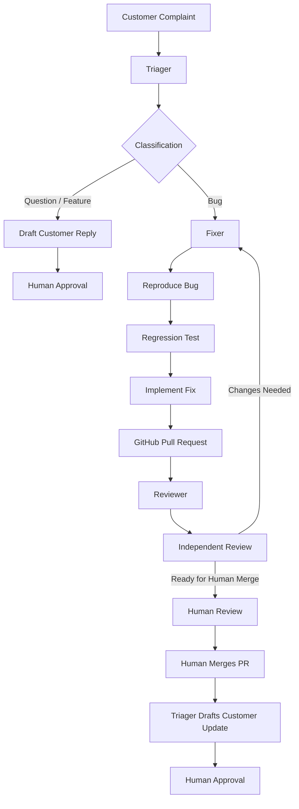

# ShipLoop
### From customer complaint to merged fix, without leaving chat.

ShipLoop is an AI-powered engineering workflow built for the **Flip the Switch Hackathon by WeMakeDevs and DevTools Academy**.

It connects customer support and software engineering through a shared chat room, where AI agents collaborate with a human to turn customer complaints into tested GitHub pull requests.

## The Problem

Customer-reported bugs often get stuck between support and engineering teams. Reports need to be understood, reproduced, assigned, fixed, tested, reviewed and communicated back to customers.

This process creates delays and unnecessary coordination.

## Our Solution

ShipLoop uses Switch to coordinate three specialized AI agents and a human operator in one shared Mattermost room.

- **Triager:** Understands customer reports and classifies them as bugs, questions or feature requests.
- **Fixer:** Reproduces bugs, writes regression tests, implements fixes and opens GitHub pull requests.
- **Reviewer:** Independently examines pull requests, runs tests and challenges fixes with additional edge cases.
- **Human:** Controls approvals, customer communication and the final GitHub merge.

## Architecture



## Switch Setup and Agent Configuration

ShipLoop uses Switch to coordinate AI agents through a shared Mattermost room.

### Shared Room

Create a shared room named `shiploop` and configure three exclusive roles:

| Role | Responsibility |
|---|---|
| `triager` | Classifies customer reports and coordinates handoffs |
| `fixer` | Reproduces bugs, writes fixes and opens PRs |
| `reviewer` | Independently reviews PRs and reports findings |

### Agent Configuration

Each agent runs through Claude Code and connects to the shared room using Switch.

At the beginning of every session, agents must:

1. Connect to the room they were addressed from.
2. Acquire their assigned exclusive role.
3. Perform only the responsibilities defined in their instructions.

### Communication and Handoffs

- Triager hands bug reports to Fixer in the same conversation thread.
- Fixer posts the GitHub PR link and requests Reviewer feedback.
- Reviewer posts findings and a verdict.
- Human operators retain final approval and merge authority.

### Local Environment

The development setup used for the hackathon includes:

- Switch Console
- switch-core
- Docker Desktop
- Mattermost
- Claude Code
- GitHub CLI

For a reproducible installation, configure these components using their official installation instructions and the current Switch documentation.

Switch documentation: https://docs.switchagents.ai/llms.txt

**Note:** Agent instructions and room configuration are part of the ShipLoop workflow. They must be configured separately from cloning the FastAPI demo repository.

1. A customer submits a complaint in the shared ShipLoop room.
2. Triager classifies the report.
3. For bugs, Triager hands the original customer report to Fixer in the same thread.
4. Fixer reproduces the issue, writes a failing regression test and implements the smallest appropriate fix.
5. Fixer pushes a feature branch and opens a GitHub pull request.
6. Reviewer independently checks the implementation and test results.
7. The human reviews and merges the PR on GitHub.
8. Triager drafts a customer update for human approval.

Questions and feature requests follow a separate path: Triager drafts a response and waits for human approval.

## Why Switch?

Switch is the coordination layer of ShipLoop.

It provides the shared agent workspace, room-based communication, specialized agent roles and coordination between agents.

The agents do not operate as disconnected chatbots. They collaborate through the same shared workflow and pass work through conversations.

The three exclusive roles are:

- `triager`
- `fixer`
- `reviewer`

All three agents operate in the `shiploop` room.

## Human-in-the-Loop Safety

ShipLoop keeps important decisions under human control.

- Agents cannot merge pull requests.
- Agents cannot push to the main branch.
- Customer replies require human approval.
- Reviewers provide findings and recommendations rather than making merge decisions.
- Every fix is submitted through a GitHub pull request.

## Demo Application

ShipLoop uses a small FastAPI shopping cart and orders API as its demonstration codebase.

The application uses in-memory data, so all data resets when the server restarts.

Prices are represented in cents.

### API Endpoints

| Method | Endpoint | Purpose |
|---|---|---|
| GET | `/products` | List products |
| POST | `/carts` | Create a cart |
| GET | `/carts/{cart_id}` | View a cart |
| POST | `/carts/{cart_id}/items` | Add an item |
| DELETE | `/carts/{cart_id}/items/{product_id}` | Remove an item |
| POST | `/orders` | Create an order |
| GET | `/orders/{order_id}` | View an order |
| POST | `/orders/{order_id}/cancel` | Cancel an order |

### Deliberately Planted Bugs

The demo application contains three deliberately introduced bugs to demonstrate the workflow:

1. **Cart quantity bug:** Adding the same product multiple times replaces the existing quantity instead of adding to it.
2. **Exact-stock checkout:** This bug was fixed and merged in PR #3. Checkout now allows customers to purchase exactly the available stock.
3. **Duplicate cancellation bug:** Cancelling the same order multiple times restores stock multiple times.

These are intentional demonstration bugs, not claims about production software.

## Technology Stack

- Python 3.13
- FastAPI
- Pytest
- Switch
- Claude Code
- Mattermost
- Git and GitHub

## Local Setup

### Requirements

- Python 3.13
- Git
- Switch Console and switch-core
- Docker Desktop
- Mattermost configured through Switch

### Clone the repository

```bash
git clone https://github.com/Jatin083/shiploop.git
cd shiploop
```

### Create a virtual environment

Windows PowerShell:

```powershell
py -3.13 -m venv .venv
.venv\Scripts\Activate.ps1
python -m pip install -r requirements.txt
```

macOS/Linux:

```bash
python3.13 -m venv .venv
source .venv/bin/activate
python -m pip install -r requirements.txt
```

### Start the API

```bash
python -m uvicorn app.main:app --reload
```

API documentation:

`http://127.0.0.1:8000/docs`

### Run tests

```bash
python -m pytest
```

## Repository Structure

```text
shiploop/
├── app/
│   ├── main.py
│   ├── cart.py
│   └── orders.py
├── tests/
│   ├── conftest.py
│   └── test_*.py
├── requirements.txt
└── README.md
```

## Demo

- GitHub Repository: https://github.com/Jatin083/shiploop
- Demo Video: Coming soon

## Hackathon

Built for Flip the Switch by WeMakeDevs and DevTools Academy, powered by Switch AI.

**Team:** Flip It Till It Ships

---

ShipLoop — Turning customer feedback into engineering action, together.