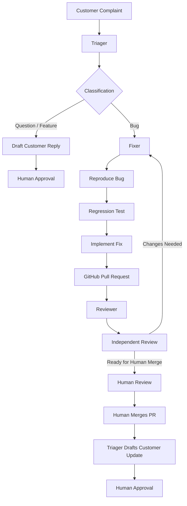

# ShipLoop
### From customer complaint to merged fix, without leaving chat.

ShipLoop is an AI-powered engineering workflow built for the **Flip the Switch Hackathon by WeMakeDevs and DevTools Academy**.

It connects customer support and software engineering through a shared Discord room, where AI agents collaborate with a human to turn customer complaints into tested GitHub pull requests.

## The Problem

Customer-reported bugs often get stuck between support and engineering teams. Reports need to be understood, reproduced, assigned, fixed, tested, reviewed and communicated back to customers.

This process creates delays and unnecessary coordination.

## Our Solution

ShipLoop uses Switch to coordinate three specialized AI agents and a human operator in one shared chat room. The final demo runs on Discord, and Mattermost is the local fallback.

- **Triager:** Understands customer reports and classifies them as bugs, questions or feature requests.
- **Fixer:** Reproduces bugs, writes regression tests, implements fixes and opens GitHub pull requests.
- **Reviewer:** Independently examines pull requests, runs tests and challenges fixes with additional edge cases.
- **Human:** Controls approvals, customer communication and the final GitHub merge.

## Architecture



## Switch Setup and Agent Configuration

ShipLoop uses Switch to coordinate AI agents through one shared chat room. The final demo uses the Discord channel `#shiploop-demo`, and the earlier Mattermost room `shiploop` is kept as a fallback.

### Shared Room

Create one shared room and configure three exclusive roles. Each agent can hold only one role at a time, so all three agents must work in the same room:

| Role | Responsibility |
|---|---|
| `triager` | Classifies customer reports and coordinates handoffs |
| `fixer` | Reproduces bugs, writes fixes and opens PRs |
| `reviewer` | Independently reviews PRs and reports findings |

### Agent Configuration

Each agent runs through Claude Code and connects to the shared room using Switch.

At the beginning of every session, agents must:

1. Connect to the room they were addressed from.
2. Acquire their assigned exclusive role.
3. Perform only the responsibilities defined in their instructions.

### Communication and Handoffs

- Triager hands bug reports to Fixer in the same conversation thread.
- Fixer posts the GitHub PR link and requests Reviewer feedback.
- Reviewer posts findings and a verdict.
- Human operators retain final approval and merge authority.

### Local Environment

The development setup used for the hackathon includes:

- Switch Console
- switch-core
- Docker Desktop
- Discord, for the final demo
- Mattermost, as the local fallback
- Claude Code
- GitHub CLI

For a reproducible installation, configure these components using their official installation instructions and the current Switch documentation.

Switch documentation: https://docs.switchagents.ai/llms.txt

**Note:** Agent instructions and room configuration are part of the ShipLoop workflow. They must be configured separately from cloning the FastAPI demo repository. See [the setup guide](docs/switch-setup.md).

## Workflow

1. A customer submits a complaint in the shared chat room.
2. Triager classifies the report.
3. For bugs, Triager hands the original customer report to Fixer in the same thread.
4. Fixer reproduces the issue, writes a failing regression test and implements the smallest appropriate fix.
5. Fixer pushes a feature branch and opens a GitHub pull request.
6. Reviewer independently checks the implementation and test results.
7. The human reviews and merges the PR on GitHub.
8. Triager drafts a customer update for human approval.

Questions and feature requests follow a separate path: Triager drafts a response and waits for human approval.

## Why Switch?

Switch is the coordination layer of ShipLoop.

It provides the shared agent workspace, room-based communication, specialized agent roles and coordination between agents.

The agents do not operate as disconnected chatbots. They collaborate through the same shared workflow and pass work through conversations.

The three exclusive roles are:

- `triager`
- `fixer`
- `reviewer`

All three agents operate in the same room.

## Human-in-the-Loop Safety

ShipLoop keeps important decisions under human control.

- Agents are instructed never to merge pull requests.
- Agents are instructed never to push to the main branch.
- Customer replies require human approval.
- Reviewers provide findings and recommendations rather than making merge decisions.
- Every fix is submitted through a GitHub pull request.

## Demo Application

ShipLoop uses a small FastAPI shopping cart and orders API as its demonstration codebase.

The application uses in-memory data, so all data resets when the server restarts.

Prices are represented in cents.

### API Endpoints

| Method | Endpoint | Purpose |
|---|---|---|
| GET | `/products` | List products |
| POST | `/carts` | Create a cart |
| GET | `/carts/{cart_id}` | View a cart |
| POST | `/carts/{cart_id}/items` | Add an item |
| DELETE | `/carts/{cart_id}/items/{product_id}` | Remove an item |
| POST | `/orders` | Create an order |
| GET | `/orders/{order_id}` | View an order |
| POST | `/orders/{order_id}/cancel` | Cancel an order |

### Deliberately Planted Bugs

The demo application was built with three deliberately introduced bugs to demonstrate the workflow:

1. **Cart quantity (fixed in [PR #8](https://github.com/Jatin083/shiploop/pull/8)):** Adding more of a product replaced the existing quantity instead of adding to it.
2. **Exact-stock checkout (fixed in [PR #3](https://github.com/Jatin083/shiploop/pull/3)):** Checkout refused an order for exactly the available stock.
3. **Duplicate cancellation (fixed in [PR #6](https://github.com/Jatin083/shiploop/pull/6)):** Cancelling the same order twice restored stock twice.

These are intentional demonstration bugs, not claims about production software.

## Verified Demo Run

The final demo ran in the Discord channel `#shiploop-demo`, using this customer complaint:

> I cancelled my order for 2 monitors, then the page froze so I pressed cancel again. Now your site shows 7 monitors in stock, but you only had 5. Something looks wrong.

The result was [PR #6](https://github.com/Jatin083/shiploop/pull/6), reviewed by the Reviewer agent and merged by a human.

| Evidence | Result |
|---|---|
| New regression test against the old code | 1 failed, 40 passed |
| Full test suite with the fix | 41 passed |
| Reviewer's 11 extra edge-case tests on the fix | All passed |
| The same 11 tests on the code before the fix | 7 failed, 4 passed |
| Merge | Human merge, commit `6abaf0a` |

The Reviewer's edge-case tests were temporary and are not stored in this repository. Their results are as reported by the Reviewer agent in the chat.

### Timing

Triager recorded these times for the report it kept:

| Step | Time (UTC, Nov 7, 2026) |
|---|---|
| Complaint received | 03:10:57.670 |
| Investigation started | 03:11:22.503 |
| PR opened | 03:11:59 |
| Human merge confirmed | 03:14:04 |
| **Total elapsed** | **3 minutes 6.33 seconds** |

The complaint was accidentally posted three times. Triager closed the older duplicates, and this time is measured from the latest post, not the first one. The time ends at the human merge, before any customer reply approval.

### Customer Update

Triager drafted a customer update. It was **not sent** to any customer.

### Second Run: PR #8

The workflow ran again in the same Discord channel for the cart quantity bug, and produced [PR #8](https://github.com/Jatin083/shiploop/pull/8). Its regression test gave 1 failed and 41 passed before the fix, and 42 passed after it. A human merged the PR. Triager recorded 5 minutes 52.978 seconds from the report in Discord to the merge. Its customer update draft was not sent.

### Known Limitations

- The fix is merged, but no production deployment exists. This is a demo application.
- Stock counts that were already inflated are not repaired by the fix.
- Concurrent cancellations may still produce incorrect stock under forced conditions.
- All data is in memory and resets when the server restarts.
- Carts can hold more than the available stock, because stock is only checked at checkout.
- Adding the same item at the exact same moment may still produce too low a cart quantity under forced conditions.
- The rule that agents never merge comes from their instructions and the permission approvals in Switch. It is not enforced by GitHub branch protection.
- GitHub Copilot review did not complete because of insufficient quota, so it is not part of this evidence.
- Switch, the chat app and the agents must be configured by hand using `docs/switch-setup.md`. Cloning the repository alone does not recreate them.

## Technology Stack

- Python 3.13
- FastAPI
- Pytest
- Switch
- Claude Code
- Discord
- Mattermost, as the local fallback
- Git and GitHub

## Local Setup

### Requirements

- Python 3.13
- Git
- Switch Console and switch-core
- Docker Desktop
- Discord or Mattermost, connected through Switch

### Clone the repository

```bash
git clone https://github.com/Jatin083/shiploop.git
cd shiploop
```

### Create a virtual environment

Windows PowerShell:

```powershell
py -3.13 -m venv .venv
.venv\Scripts\Activate.ps1
python -m pip install -r requirements.txt
```

macOS/Linux:

```bash
python3.13 -m venv .venv
source .venv/bin/activate
python -m pip install -r requirements.txt
```

### Start the API

```bash
python -m uvicorn app.main:app --reload
```

API documentation:

`http://127.0.0.1:8000/docs`

### Run tests

```bash
python -m pytest
```

## Repository Structure

```text
shiploop/
├── app/
│   ├── main.py
│   ├── cart.py
│   └── orders.py
├── docs/
│   ├── agent-instructions/
│   ├── architecture.md
│   ├── demo-script.md
│   └── switch-setup.md
├── tests/
│   ├── conftest.py
│   └── test_*.py
├── requirements.txt
└── README.md
```

## Demo

- GitHub Repository: https://github.com/Jatin083/shiploop
- Demo Video: Coming soon

## Hackathon

Built for Flip the Switch by WeMakeDevs and DevTools Academy, powered by Switch AI.

**Team:** Flip It Till It Ships

---

ShipLoop — Turning customer feedback into engineering action, together.