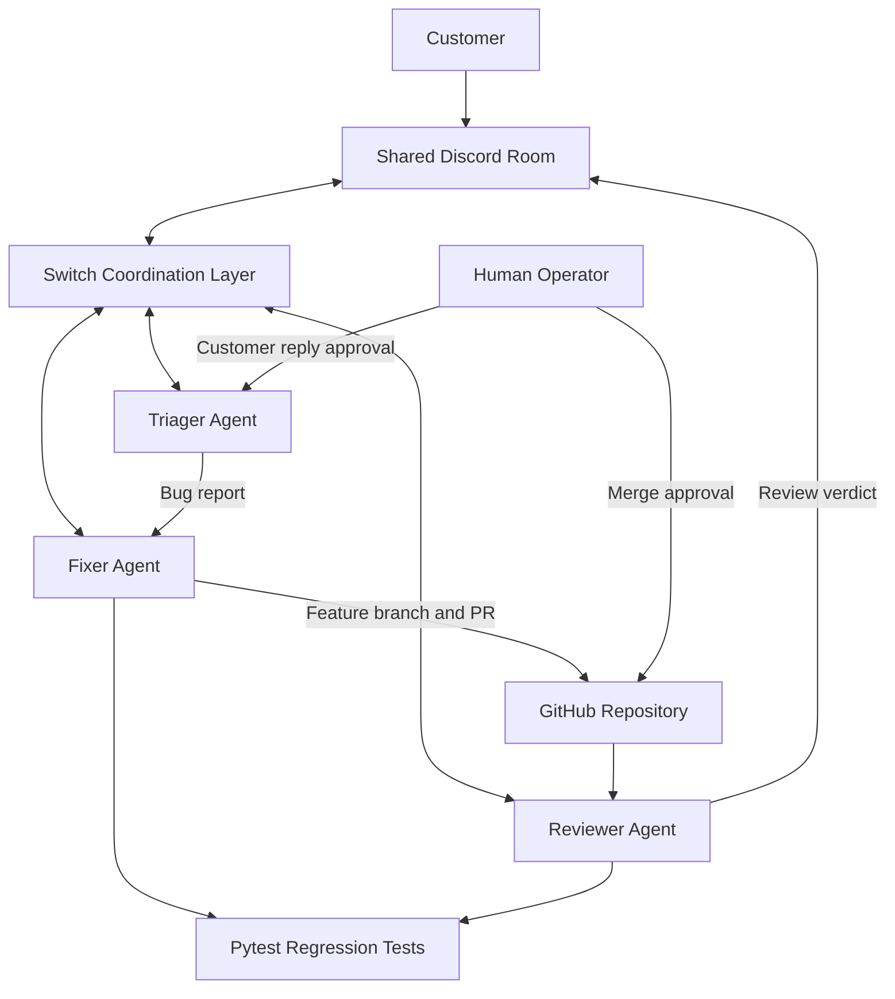

# ShipLoop Architecture

## 1. Overview

ShipLoop is a multi-agent workflow that connects customer support and software engineering through Switch.

Its architecture combines:

- Switch for agent coordination and role management.
- Discord for shared team communication in the final demo, with Mattermost as the local fallback.
- Claude Code for agent execution.
- GitHub for version control and pull requests.
- FastAPI for the demonstration shopping application.
- Pytest for regression testing.

## 2. High-Level Architecture

## 3. Agent Responsibilities

### Triager

- Receives customer reports.
- Classifies bugs, questions and feature requests.
- Hands bugs to Fixer in the same thread.
- Drafts customer responses for human approval.
- Tracks workflow timestamps where reliable event data is available.

### Fixer

- Reproduces reported bugs.
- Writes regression tests.
- Confirms the test fails before the fix.
- Implements the smallest appropriate change.
- Runs the test suite.
- Creates a feature branch and GitHub pull request.

### Reviewer

- Inspects the pull request independently.
- Checks the reported bug and regression test.
- Identifies potential edge cases.
- Runs additional tests in its own workspace.
- Reports findings and a review verdict.

## 4. Human Control

Humans retain authority over:

- GitHub pull request merges.
- Customer communication approval.
- Final acceptance of fixes.

Agents do not merge pull requests or push directly to main.

## 5. Example Bug Lifecycle

Customer complaint:

"You had exactly 5 monitors left. I tried to buy all 5, but checkout said there wasn't enough stock."

The original bug was caused by a stock comparison that incorrectly rejected an order equal to the available inventory.

Fixer created a regression test and corrected the comparison.

The change was submitted through GitHub PR #3 and reviewed before human-controlled merging.

## 6. Design Principles

- Shared communication instead of disconnected agent conversations.
- Specialized agents with exclusive roles.
- One bug per pull request.
- Regression tests before implementation.
- Independent review.
- Human-controlled approvals.
- Reproducible development practices.

## 7. Limitations

The demonstration shopping API uses in-memory data. Data resets when the server restarts.

Switch, the chat app and Claude Code require separate local configuration. Cloning the repository alone does not recreate the complete agent environment.